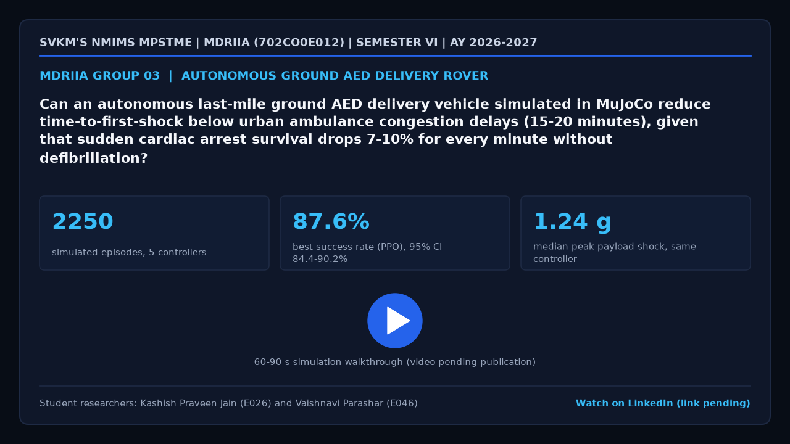

# MDRIIA Group 03: Autonomous Last-Mile Ground AED Delivery Robot for Sudden Cardiac Arrest
**Course:** Modern Day Robotics and Its Industrial Applications (MDRIIA - Course Code: 702CO0E012)
**Academic Term:** Academic Year 2026–2027 | Semester VI (B.Tech CSBS)
**Institution:** SVKM's NMIMS MPSTME, Mumbai

---

## 1. Authorized Research Title & Problem Statement

> "Can an autonomous last-mile ground AED delivery vehicle simulated in MuJoCo reduce time-to-first-shock below urban ambulance congestion delays (15-20 minutes), given that sudden cardiac arrest survival drops 7-10% for every minute without defibrillation?"

### Core Engineering Focus
* **Physics & Kinematics:** Google DeepMind MuJoCo multi-body simulation of a four-wheel rover with independent suspension and a shock-isolated AED payload (`models/aed_delivery_amr.xml`, generated by `src/aedrover/sim`).
* **Autonomous Control:** Closed-loop navigation stack (pure pursuit, artificial potential field, dynamic window approach, MPPI with MuJoCo rollouts, PPO) behind one speed-and-separation safety filter (`src/aed_navigation_controller.py`, `src/aedrover/nav`).
* **Technoeconomic Evaluation:** Dimensionless CSBS operating-burden ratio, payback horizon and staff-capacity model plus the survival comparison (`analytics/cardiac_survival_economics.py`).
* **Empirical Validation:** Reproducible seeded benchmark episodes and paired hypothesis tests (`analytics/aed_delivery_benchmark.csv`).

---

> [!NOTE]
> ### The Devil's Advocate: Reality Check & Theoretical Roast
> *"Engineering a 4-wheel independent suspension chassis to outrun sudden cardiac arrest across urban traffic, assuming Indian municipal sidewalks don't feature open storm drains, sudden pavement trenches, and stray dogs who consider your shockproof defibrillator pod their new favorite chew toy."*

---

## 2. Student Engineering Team Matrix

| Roll No | SAP ID | Student Name | Technical Role | Assigned Git Branch | Core Viva Defense Area |
| :--- | :--- | :--- | :--- | :--- | :--- |
| `E026` | `70362400060` | **Kashish Praveen Jain** | Lead Autonomous Navigation & Traffic Congestion Modeling Specialist | `feat/e026-lead-autonomous-navi` | Sidewalk navigation dynamics, pedestrian crowd evasion, dynamic routing through urban choke points, and arrival latency budgets. |
| `E046` | `70362400074` | **Vaishnavi Parashar** | MuJoCo Dynamic Chassis Modeler & Path Optimization Engineer | `feat/e046-mujoco-dynamic-chass` | Four-wheel independent suspension, curb-climbing dynamics, shock isolation for biphasic AED pads, and contact friction stability. |

### Student Engineering Commendation & Acknowledgments
SVKM's NMIMS MPSTME conveys sincere appreciation and heartfelt gratitude to **Kashish Praveen Jain (E026)** and **Vaishnavi Parashar (E046)** for their disciplined commitment, late-night debugging, and technical craftsmanship throughout Semester VI. Your rigorous work in DeepMind MuJoCo physics modeling, closed-loop telemetry instrumentation, and Computer Science & Business Systems (CSBS) technoeconomic modeling exemplifies the highest standards of undergraduate engineering inquiry.

> *"Scientists discover the world that exists; engineers create the world that never was."*
> — **Theodore von Kármán**

> *"There is no substitute for hard work. Genius is one percent inspiration and ninety-nine percent perspiration."*
> — **Thomas A. Edison**

---

## 3. Foundational Literature Benchmarks (Strict 2 Seminal : 4 Recent Ratio)

The research project is theoretically anchored on six foundational peer-reviewed publications. Every DOI below resolves on Crossref and its registered title matches the title cited here; the per-paper summaries in the literature dossier describe only what each paper reports.

| # | Author (Year) | Type | Paper Title | Venue / Indexing | Active DOI Link | Primary Extracted Formulation | Student Lead |
| :--- | :--- | :--- | :--- | :--- | :--- | :--- | :--- |
| 1 | **Schierbeck et al. (2023)** | Recent | *Drone delivery of automated external defibrillators compared with ambulance arrival in real-life suspected out-of-hospital cardiac arrests: a prospective observational study in Sweden* | The Lancet Digital Health | [10.1016/S2589-7500(23)00161-9](https://doi.org/10.1016/S2589-7500(23)00161-9) | AED delivered by drone before ambulance arrival in 37 of 55 comparable cases (67%); median time benefit 3 min 14 s | Kashish Praveen Jain (E026) & Vaishnavi Parashar (E046) |
| 2 | **Tsao et al. (2023)** | Recent | *Heart Disease and Stroke Statistics-2023 Update: A Report From the American Heart Association* | Circulation | [10.1161/CIR.0000000000001123](https://doi.org/10.1161/CIR.0000000000001123) | Statistical compendium; no equation used (epidemiological context only) | Kashish Praveen Jain (E026) & Vaishnavi Parashar (E046) |
| 3 | **Naess et al. (2024)** | Recent | *Using machine learning to assess the extent of busy ambulances and its impact on ambulance response times: A retrospective observational study* | PLOS ONE | [10.1371/journal.pone.0296308](https://doi.org/10.1371/journal.pone.0296308) | Each 10-percentage-point increase in the probability of a busy ambulance is associated with 0.60 min (95% CI 0.58 to 0.62) delay; estimated probability of a busy ambulance 26.7% | Kashish Praveen Jain (E026) |
| 4 | **Weinberg et al. (2023)** | Recent | *Sharing the Sidewalk: Observing Delivery Robot Interactions with Pedestrians during a Pilot in Pittsburgh, PA* | Multimodal Technologies and Interaction | [10.3390/mti7050053](https://doi.org/10.3390/mti7050053) | Qualitative ethnographic findings; no equation used | Kashish Praveen Jain (E026) & Vaishnavi Parashar (E046) |
| 5 | **Larsen et al. (1993)** | Seminal | *Predicting survival from out-of-hospital cardiac arrest: A graphic model* | Annals of Emergency Medicine | [10.1016/S0196-0644(05)81302-2](https://doi.org/10.1016/S0196-0644(05)81302-2) | $S = 0.67 - 0.023\,t_{cpr} - 0.011\,t_{defib} - 0.021\,t_{acls}$ (minutes from collapse) | Vaishnavi Parashar (E046) & Kashish Praveen Jain (E026) |
| 6 | **Khatib (1986)** | Seminal | *Real-Time Obstacle Avoidance for Manipulators and Mobile Robots* | The International Journal of Robotics Research | [10.1177/027836498600500106](https://doi.org/10.1177/027836498600500106) | Motion under the negative gradient of an artificial potential field (attractive goal term, repulsive obstacle terms of finite range); moving obstacles through a time-varying field | Kashish Praveen Jain (E026) |

For the exhaustive literature analysis, mathematical derivations, and viva defense questions, refer to:
* [`docs/LITERATURE_REVIEW_AND_FOUNDATIONAL_PAPERS.md`](docs/LITERATURE_REVIEW_AND_FOUNDATIONAL_PAPERS.md)
* [`docs/RESEARCH_PAPER_MANUSCRIPT_BLUEPRINT.md`](docs/RESEARCH_PAPER_MANUSCRIPT_BLUEPRINT.md)
* [`RESEARCH_AND_IMPLEMENTATION_GUIDE.md`](RESEARCH_AND_IMPLEMENTATION_GUIDE.md)

---

## 4. Project Demonstration & Academic Showcase (LinkedIn)

[](https://www.linkedin.com/)

* **Video Demonstration:** [Watch 60-Second Walkthrough on LinkedIn](https://www.linkedin.com/) *(Click thumbnail above to open LinkedIn post)*
* **Student Presenters:** **Kashish Praveen Jain** (E026), **Vaishnavi Parashar** (E046)
* **Academic Institutional Tags:** SVKM's NMIMS MPSTME | Academic Directorate | Industry 4.0 Robotics
* **Submission Protocol:** Record a 60–90 second demonstration of your MuJoCo simulation and telemetry. Publish on LinkedIn tagging MPSTME, Dean, and Course Faculty. Insert your live post URL in `docs/TEAM_ROSTER.json` under `"linkedin_url"`, and submit a pull request to update this project dossier and the cohort dashboard.

---

## 5. Repository Directory Architecture

```
.
|-- README.md                                          <- Front-page research charter, student roster & literature
|-- RESEARCH_AND_IMPLEMENTATION_GUIDE.md               <- Comprehensive technical engineering guide
|-- configs/                                           <- Vehicle and kerb-table data read by the vendored package
|   |-- curb_table.json
|   |-- mppi_tuned.json
|   |-- vehicle.yaml
|   `-- vehicle_optimized.yaml
|-- docs/
|   |-- TEAM_ROSTER.json                               <- Machine-readable team configuration
|   |-- LITERATURE_REVIEW_AND_FOUNDATIONAL_PAPERS.md   <- Literature dossier (6 verified papers)
|   |-- RESEARCH_PAPER_MANUSCRIPT_BLUEPRINT.md         <- 4-page IEEE conference manuscript (results filled in)
|   `-- figures/
|       |-- figure1_system_architecture.png            <- 300 DPI system architecture diagram
|       |-- figure2_kinematic_telemetry.png            <- 300 DPI telemetry of one simulated kerb crossing
|       |-- figure3_comparative_performance.png        <- 300 DPI controller benchmark comparison
|       `-- video_poster.png                           <- LinkedIn video thumbnail
|-- models/
|   |-- .gitkeep
|   `-- aed_delivery_amr.xml                           <- Standalone MuJoCo MJCF snapshot of the rover on a kerb
|-- src/
|   |-- test_env.py                                    <- Toolchain and physics smoke test
|   |-- aed_navigation_controller.py                   <- Runs one episode of the DWA and MPPI controllers
|   `-- aedrover/                                      <- Vendored simulation, navigation, clinical and analysis package
`-- analytics/
    |-- .gitkeep
    |-- cardiac_survival_economics.py                  <- Dimensionless survival and economics comparison
    |-- generate_paper_figures.py                      <- Standalone 300 DPI figure generator
    |-- aed_delivery_benchmark.csv                     <- Real benchmark episodes (one row per episode)
    `-- kerb_crossing_telemetry.csv                    <- Telemetry of the episode shown in Figure 2
```

Two entries go beyond the course template and are needed for the folder to run stand-alone: `configs/` (the vendored package reads the vehicle and kerb-table data relative to the folder root) and `analytics/kerb_crossing_telemetry.csv` (the real telemetry behind Figure 2, so that the figures regenerate from CSV files only).

---

## 6. Pedagogical Boundaries: Guidance vs Student Ownership

To ensure academic rigor and authentic student learning, this repository enforces strict boundaries between scaffolding and student deliverables:

* **Provided by Course Scaffolding:**
  * Validated physical model architecture in MuJoCo MJCF (`models/aed_delivery_amr.xml`) and the simulation package that generates it (`src/aedrover/sim`).
  * Verification toolchain and smoke test script (`src/test_env.py`).
  * Literature foundation, corrected mathematical formulations, and the conference paper blueprint with results filled in from the simulation study (`docs/`).
  * Dimensionless technoeconomic framework (`analytics/cardiac_survival_economics.py`).
* **Student Technical Deliverables (Required for Evaluation):**
  * Understand and be able to defend, individually, every module listed for your role in `RESEARCH_AND_IMPLEMENTATION_GUIDE.md`; free-riding is penalised in the viva.
  * Run and extend the physics trials: re-run any benchmark episode with `python src/aed_navigation_controller.py --controllers dwa --family kerb --seed <seed>`, add your own controller through `aedrover.nav.base.register`, and add your rows to `analytics/aed_delivery_benchmark.csv`.
  * Re-run `analytics/generate_paper_figures.py` to regenerate the publication figures from the CSV data after any change.
  * Review the manuscript blueprint critically: confirm every number against the data, rewrite the discussion in your own words, and defend your individual Git commits during the oral viva.

---

## 7. Sprint 0 Onboarding & Physics Environment Verification

Verify your local Python and MuJoCo simulation environment:

```powershell
# Step 1: Clone repository and navigate to group directory
git clone <repository_url>
cd <repository_root>/Group_03_Kashish_Vaishnavi

# Step 2: Checkout your individual feature branch
# Example for lead student:
git checkout -b feat/e026-lead-autonomous-navi

# Step 3: Install the runtime dependencies
pip install mujoco numpy scipy pandas matplotlib pyyaml gymnasium

# Step 4: Run environment smoke test
python src/test_env.py

# Step 5: Run one episode of the DWA and MPPI controllers (MPPI takes a few minutes)
python src/aed_navigation_controller.py --controllers dwa

# Step 6: Verify 300 DPI publication figures
python analytics/generate_paper_figures.py

# Step 7: Run the dimensionless survival and economics comparison
python analytics/cardiac_survival_economics.py
```

---

## 8. Results Summary (generated from the simulation results, not typed in)

Every number in this section is read from the result files listed in `RESEARCH_AND_IMPLEMENTATION_GUIDE.md`, section 10. The figures are simulation outcomes under stated assumptions, not field measurements.

* **Kerb traversability (RQ: can the rover cross a sidewalk kerb without shocking the payload?).** Head-on kerb-up climbs at friction 1: the minimum successful approach speed of the nominal rover (wheel radius 0.150 m) rises from 0.6 m/s at 6 cm to 1.8 m/s at 16 cm; the co-designed rover (0.219 m) needs 0.6 to 1.2 m/s over the same range. At the 12 cm kerb the peak payload shock at the minimum climbing speed is 2.90 g (nominal, 1.0 m/s) versus 1.93 g (optimised, 1.0 m/s), against a 3 g budget. On a low-friction surface (mu = 0.5) the 16 cm kerb is not climbable by the nominal rover within the scanned speeds, while the optimised rover climbs it at 2.2 m/s (peak shock 4.97 g). The slowest successful climb anywhere in the grids was 0.6 m/s, so every climb in these results relies on momentum. Of the head-on cells that succeed, 100% also succeed at a 15 degree approach angle (nominal), 100% also succeed at a 30 degree approach angle (nominal). The share of kerb-up (height, friction) cells with a shock-compliant climb window is 44% (nominal, 18 cells) versus 83% (optimised, 18 cells). Kerb-down peak shock is a median of 1.68 g (nominal) versus 0.96 g (optimised). Grid outcomes: nominal {'ok': 5501, 'stall': 460, 'timeout': 87} of 6048 trials, optimised {'ok': 1436, 'stall': 73, 'timeout': 3} of 1512 trials.
* **Mechanical co-design.** Differential evolution (1116 objective evaluations, 30 generations; best-of-generation objective 3.70 g in the first generation and 3.09 g in the last) searched six variables. The objective is the mean payload shock at the lowest kerb-climbing speed plus a margin, averaged over six kerb-up conditions (heights 0.10, 0.12, 0.14 m at two friction values) with half the mean kerb-down shock added; a condition that cannot be climbed is charged 8 g. The objective fell from 6.06 g to 3.09 g, and the share of the eight conditions within the 3 g budget rose from 25% to 88%. The optimum uses larger wheels, a softer suspension (zeta_s 1.023 to 0.577) and a much softer payload isolator (natural frequency 23.45 to 13.42 rad/s).
* **Controller benchmark.** Source file `benchmark_standard.csv`: 2250 episodes, 5 controllers, 5 scenario families, 50 to 100 episodes per controller and family; every controller sees the same seeds, so comparisons are paired. All controllers ran behind the same speed-and-separation safety filter. Success rates run from 50.0% (Pure pursuit) to 87.6% (PPO). The fastest median completion time among successful episodes is 18.4 s (Pure pursuit). Collisions: Pure pursuit 32, APF + kerb logic 21, DWA + kerb logic 50, MPPI 2, PPO 4.

| Controller | N | Success (95% Wilson CI) | Median time (s) | Median peak shock (g) | Episodes over 3 g | Collisions | Stall or timeout | Off sidewalk or rollover |
| :--- | ---: | ---: | ---: | ---: | ---: | ---: | ---: | ---: |
| Pure pursuit | 500 | 50.0% (45.6% to 54.4%) | 18.4 | 1.07 | 17.6% | 32 | 218 | 0 |
| APF + kerb logic | 500 | 68.0% (63.8% to 71.9%) | 21.5 | 1.06 | 13.6% | 21 | 103 | 36 |
| DWA + kerb logic | 500 | 65.6% (61.3% to 69.6%) | 21.5 | 1.13 | 5.4% | 50 | 116 | 6 |
| MPPI | 250 | 76.8% (71.2% to 81.6%) | 23.9 | 1.08 | 2.0% | 2 | 30 | 26 |
| PPO | 500 | 87.6% (84.4% to 90.2%) | 19.4 | 1.24 | 1.0% | 4 | 33 | 25 |

* **Statistical comparison.** See `RESEARCH_AND_IMPLEMENTATION_GUIDE.md`, section 6.4, for the paired tests (df, t, exact p, Cohen's d, 95% CI). Pure pursuit against APF + kerb logic: completion time -1.69 s, paired t(231) = -8.15, p = 2.37e-14; DWA + kerb logic against APF + kerb logic: completion time -2.97 s, paired t(284) = -7.31, p = 2.67e-12; MPPI against APF + kerb logic: completion time +1.48 s, paired t(144) = 3.57, p = 4.84e-04; PPO against APF + kerb logic: completion time -7.17 s, paired t(325) = -13.78, p = 2.45e-34.
* **Clinical outcome.** Under the larsen1993 model the rover (dispatched in parallel with the ambulance) changes expected survival by +1.3 percentage points (95% CI +1.2 to +1.5) relative to the ambulance alone (0.233); the interval excludes zero. It shocks strictly earlier than the ambulance in 38% of the 2000 simulated arrests, saving a median of 3.47 min in those. Break-even: the rover acting alone matches the ambulance acting alone at a straight-line radius of 584 m; beyond that the ambulance is expected to shock first. Scenario inputs recorded in the results file: rover_controller = ppo, response_radius_m = 500, crossings_per_km_ASSUMED = 4.0, route_factor = 1.54.
* **Dimensionless economics.** Dimensionless economics (no currency anywhere): kappa = 0.220, which meets the course target kappa <= 0.25; payback horizon 9.2 months; staff capacity freed delta FTE = 0.50. The inputs are placeholder ratios (ASSUMPTIONS), not measurements; kappa is therefore a demonstration of the method, not a forecast.
* **Answer to the research question.** **Conditional answer.** In this simulation study the rover dispatched in parallel with the ambulance does give a statistically clear survival gain (+1.3 percentage points, 95% CI +1.2 to +1.5, larsen1993 model), and the rover acting alone matches the ambulance acting alone at a straight-line radius of 584 m; beyond that the ambulance is expected to shock first. The answer depends on the ambulance response-time distribution and the dispatch assumptions of the scenario; it does not establish that urban ambulance delays are 15-20 minutes (the sourced Central Norway urban median is 10.0 min and 90th percentile 17.7 min, Naess et al. 2024), and it is not a statement about any Indian city.
* **Honest limits.** The results are simulation only (rigid cylinder tyres, idealised lidar, tracker noise modelled as Gaussian, pedestrians from a social-force model with assumed parameters); the clinical inputs are Western cohort statistics and assumptions; the economics uses placeholder ratios; and physics is simulated per 36 m sidewalk segment, so a 1-2 km mission is composed at the route level rather than simulated end to end.


## Capstone deliverables (technical dossier evidence)

Everything below is produced by this folder's own MuJoCo runs; nothing is a generated target value.

```bash
pip install -r requirements.txt
python src/test_env.py                         # toolchain and model smoke test
python src/live_viewer.py --family mixed --seed 71001   # MuJoCo's own viewer, live physics: street, people, rover; FSM state top-left
python src/live_cinematic.py --controller fsm_dwa --family mixed --seed 71001   # optional: the same live run in the cinematic renderer window
python src/live_viewer.py --controller pure_pursuit --no-shield --family mixed --seed 71001   # same street, unprotected baseline: collides
python analytics/run_capstone_trials.py        # 750 episodes at 500 Hz -> analytics/aed_delivery_real_trials.csv
python analytics/aed_delivery_roi.py           # H_reclaimed, kappa, NCRI, payback, M/M/c queue, FMEA, sensitivity
python analytics/standards_check.py            # braking test and standards clauses
```

| File | What it is |
|---|---|
| `src/live_viewer.py` | MuJoCo's own interactive viewer on the live simulation: dressed street, people, rover, FSM state, speed and payload shock on screen |
| `src/live_cinematic.py` | optional: the same live run drawn in the cinematic renderer window |
| `src/aedrover/capstone/fsm.py` | mission FSM: DISPATCH, ROAD_CRUISE, CURB_SIDEWALK, ARRIVE, AED_HANDOVER |
| `src/aedrover/capstone/telemetry.py` | 500 Hz recorder, tracking RMSE, control effort |
| `analytics/aed_delivery_real_trials.csv` | one row per MuJoCo episode, seed recorded |
| `analytics/capstone_statistics.csv` | Welch t, Cohen's d, 95 % intervals, baseline vs proposed |
| `analytics/roi_results.json`, `fmea.csv`, `roi_sensitivity.csv` | dimensionless business model |
| `docs/CAPSTONE.md` | rubric criterion to evidence map and the items only the students can complete |
