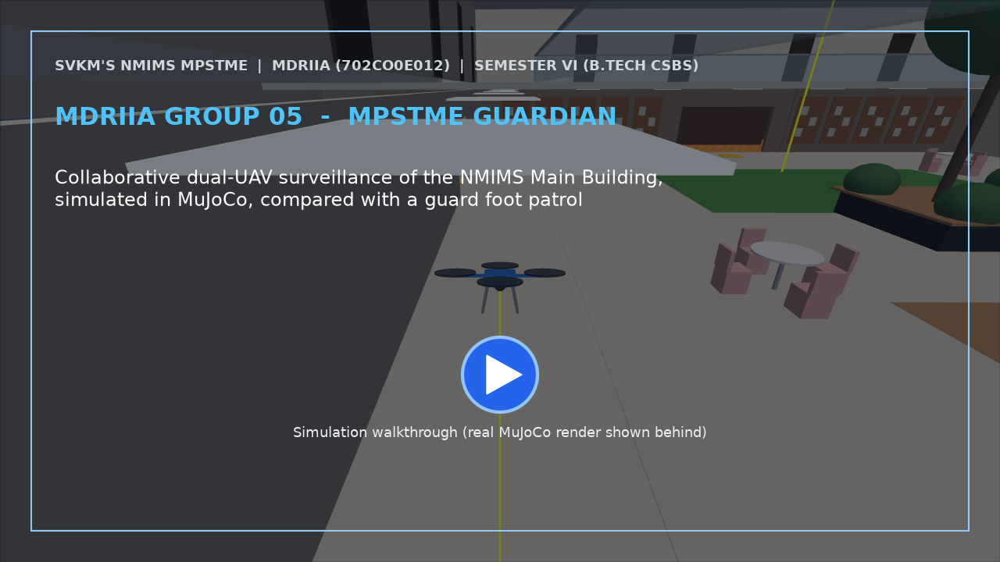

# MDRIIA Group 05: Collaborative Dual-UAV Campus Perimeter Patrol and Surveillance
**Course:** Modern Day Robotics and Its Industrial Applications (MDRIIA - Course Code: 702CO0E012)  
**Academic Term:** Academic Year 2026–2027 | Semester VI (B.Tech CSBS)  
**Institution:** SVKM's NMIMS MPSTME, Mumbai  

---

## 1. Authorized Research Title & Problem Statement

> "To what extent can a collaborative dual-UAV surveillance system simulated in MuJoCo optimize campus perimeter patrol cycle time and OpenCV human detection latency compared to static security guard patrols?"

### Core Engineering Focus
* **Physics & Kinematics:** Google DeepMind MuJoCo multi-body dynamic physics simulation (`models/campus_perimeter_patrol.xml`).
* **Autonomous Control:** Closed-loop Python control architecture with student implementation boundaries (`src/aerial_patrol_swarm.py`).
* **Technoeconomic Evaluation:** Dimensionless CSBS operational economics and return on investment model (`analytics/campus_security_economics.py`).
* **Empirical Validation:** Reproducible benchmark trials and statistical hypothesis testing (`analytics/campus_patrol_real_trials.csv`).

---

> [!NOTE]
> ### The Devil's Advocate: Reality Check & Theoretical Roast
> *"Architecting a cooperative multi-agent aerial consensus protocol to detect campus perimeter breaches, completely ignoring that 15-knot coastal sea breezes, campus WiFi dead zones, and a flock of territorial pigeons will immediately turn your decentralized swarm consensus into a synchronized double-tree landing."*

---

## 2. Student Engineering Team Matrix

| Roll No | SAP ID | Student Name | Technical Role | Assigned Git Branch | Core Viva Defense Area |
| :--- | :--- | :--- | :--- | :--- | :--- |
| `E043` | `70362400030` | **Muaaz Mohammed Iqbal Shaikh** | Lead UAV Flight Dynamics, Path Planner & Coordinated Fleet Architect | `feat/e043-lead-uav-flight-dyna` | Dual-quadrotor 6-DOF aerodynamics, thrust-to-weight modeling, waypoint coverage optimization, and inter-UAV collision avoidance. |
| `E051` | `70362400067` | **Aditya Rajkumar** | Computer Vision, OpenCV Human Detection & Tracking Specialist | `feat/e051-computer-vision-open` | Downward aerial OpenCV human detection pipeline, bounding box latency, false alarm mitigation, and target handoff tracking. |
| `E075` | `70362400003` | **Zaid Rezaur Rahman** | Restricted-Zone Geo-Fencing & Intrusion Telemetry Lead | `feat/e075-restricted-zone-geo-` | Ray-casting point-in-polygon geo-fencing, simulated GPS/IMU noise injection, and real-time perimeter breach logging. |
| `E077` | `70362400080` | **Soumya Subhankar Ranasingh** | CSBS Campus Security Operations & OpEx Payback Analyst | `feat/e077-csbs-campus-security` | Guard labor substitution modeling, patrol revisit-time comparison against the guard baseline (measured in simulation, see section 5.3), and multi-year drone fleet OpEx payback analysis. |


### Student Engineering Commendation & Acknowledgments
SVKM's NMIMS MPSTME conveys sincere appreciation and heartfelt gratitude to **Muaaz Mohammed Iqbal Shaikh (E043)**, **Aditya Rajkumar (E051)**, **Zaid Rezaur Rahman (E075)**, and **Soumya Subhankar Ranasingh (E077)** for their disciplined commitment, late-night debugging, and technical craftsmanship throughout Semester VI. Your rigorous work in DeepMind MuJoCo physics modeling, closed-loop telemetry instrumentation, and Computer Science & Business Systems (CSBS) technoeconomic modeling exemplifies the highest standards of undergraduate engineering inquiry.

> *"Scientists discover the world that exists; engineers create the world that never was."*  
> — **Theodore von Kármán**

> *"There is no substitute for hard work. Genius is one percent inspiration and ninety-nine percent perspiration."*  
> — **Thomas A. Edison**

---

## 3. Foundational Literature Benchmarks (Strict 2 Seminal : 4 Recent Ratio)

The research project is theoretically anchored on six foundational peer-reviewed publications validated against global bibliographic databases.

| # | Author (Year) | Type | Paper Title | Venue / Indexing | Active DOI Link | Primary Extracted Formulation | Student Lead |
| :--- | :--- | :--- | :--- | :--- | :--- | :--- | :--- |
| 1 | **Guerrero-Bonilla et al. (2021)** | Recent | *Perimeter Surveillance Based on Set-Invariance* | IEEE Robotics and Automation Letters | [https://doi.org/10.1109/LRA.2020.3028055](https://doi.org/10.1109/LRA.2020.3028055) | `Control Barrier Function h(x) \ge 0; barrie...` | Muaaz Mohammed Iqbal Shaikh (E043) & Zaid Rezaur Rahman (E075) |
| 2 | **Javaid et al. (2023)** | Recent | *Communication and Control in Collaborative UAVs: Recent Advances and Future Trends* | IEEE Transactions on Intelligent Transportation Systems | [https://doi.org/10.1109/TITS.2023.3248841](https://doi.org/10.1109/TITS.2023.3248841) | `Network consensus equation \dot{x}_i = -\sum...` | Muaaz Mohammed Iqbal Shaikh (E043) |
| 3 | **Wu et al. (2024)** | Recent | *Multi-UAV Collaborative Dynamic Task Allocation Method Based on ISOM and Attention Mechanism* | IEEE Transactions on Vehicular Technology | [https://doi.org/10.1109/TVT.2023.3341878](https://doi.org/10.1109/TVT.2023.3341878) | `Task allocation utility U = \sum_{i} (w_1 T_...` | Soumya Subhankar Ranasingh (E077) & Muaaz Shaikh (E043) |
| 4 | **Cabreira et al. (2019)** | Seminal | *Survey on Coverage Path Planning with Unmanned Aerial Vehicles* | Drones | [https://doi.org/10.3390/drones3010004](https://doi.org/10.3390/drones3010004) | `Coverage time T_{\text{cov}} = \frac{A}{w_{\...` | Zaid Rezaur Rahman (E075) & Aditya Rajkumar (E051) |
| 5 | **Mittal et al. (2020)** | Recent | *Deep learning-based object detection in low-altitude UAV datasets: A survey* | Image and Vision Computing | [https://doi.org/10.1016/j.imavis.2020.104046](https://doi.org/10.1016/j.imavis.2020.104046) | `Mean Average Precision \text{mAP} = \frac{1}...` | Aditya Rajkumar (E051) |
| 6 | **Agmon et al. (2008)** | Seminal | *Multi-robot perimeter patrol in adversarial settings* | IEEE International Conference on Robotics and Automation (ICRA) | [https://doi.org/10.1109/ROBOT.2008.4543563](https://doi.org/10.1109/ROBOT.2008.4543563) | `Maximum patrol time lag T_{\text{lag}} = \ma...` | Muaaz Shaikh (E043) & Soumya Subhankar Ranasingh (E077) |

For the exhaustive literature analysis, mathematical derivations, and viva defense questions, refer to:
* [`docs/LITERATURE_REVIEW_AND_FOUNDATIONAL_PAPERS.md`](docs/LITERATURE_REVIEW_AND_FOUNDATIONAL_PAPERS.md)
* [`docs/RESEARCH_PAPER_MANUSCRIPT_BLUEPRINT.md`](docs/RESEARCH_PAPER_MANUSCRIPT_BLUEPRINT.md)

---

## 4. Project Demonstration & Academic Showcase (LinkedIn)

[](https://www.linkedin.com/)

* **Video Demonstration:** 3:00-4:00 minute walkthrough on LinkedIn (course Showcase Guide section 7). **Link: the post is not published yet.** The thumbnail above links to the LinkedIn home page until `linkedin_url` in `docs/TEAM_ROSTER.json` holds the real post URL.
* **Student Presenters:** **Muaaz Mohammed Iqbal Shaikh (E043)**, **Aditya Rajkumar (E051)**, **Zaid Rezaur Rahman (E075)**, **Soumya Subhankar Ranasingh (E077)**
* **Academic Institutional Tags:** SVKM's NMIMS MPSTME | Academic Directorate | Industry 4.0 Robotics
* **Submission Protocol:** Record a 3:00-4:00 minute demonstration of the live MuJoCo simulation (both scenes), the results and the business graph, with a webcam picture-in-picture of every member (script: `docs/submission/video_script_and_shotlist.md`). Publish on LinkedIn tagging MPSTME, Dean, and Course Faculty. Insert your live post URL in `docs/TEAM_ROSTER.json` under `"linkedin_url"`, and submit a pull request to update this project dossier and the cohort dashboard.

---

## 5. Repository Directory Architecture

```
.
|-- README.md                                    <- Front-page research charter, student roster & literature
|-- requirements.txt                             <- pinned Python dependencies
|-- RESEARCH_AND_IMPLEMENTATION_GUIDE.md         <- Course guide (frozen -- do not edit)
|-- docs/
|   |-- TEAM_ROSTER.json                         <- Machine-readable team configuration
|   |-- MDRIIA_Group_05_Technical_Dossier.docx   <- course dossier template (filled copy is a separate file)
|   |-- LITERATURE_REVIEW_AND_FOUNDATIONAL_PAPERS.md
|   |-- RESEARCH_PAPER_MANUSCRIPT_BLUEPRINT.md   <- 4-page IEEE manuscript (all authors)
|   |-- planning/                                <- PRD + Implementation & Review Plan (PDF)
|   |   `-- source/                              <- HTML + Mermaid sources and PDF builder
|   |-- research/                                <- verified sources, MJCF parameter justification
|   |-- submission/                              <- email draft, video script, peer review, checklists (drafts)
|   `-- figures/
|       |-- trajectory_<scene>.png               <- plan view of one run per condition (from the trial telemetry)
|       |-- revisit_boxplot_<scene>.png          <- worst_revisit_ground_s per condition (from the trial CSV)
|       |-- interior_obstacle_clearance.png      <- FR-18 clearance of the interior UAV runs
|       |-- video_poster.png                     <- title card over a real MuJoCo render
|       |-- interior/                            <- interior renders, patrol video
|       `-- exterior/                            <- exterior renders + real-vs-sim comparison
|-- models/
|   |-- campus_perimeter_patrol.xml              <- DEFAULT: inside the NMIMS Main Building     [E043]
|   |-- campus_perimeter_patrol_exterior.xml     <- variant: patrol of the campus compound INSIDE the boundary wall [E043]
|   |-- common.xml                               <- shared materials + default classes
|   |-- uav_fleet.xml                            <- both quadrotors, cameras, actuators, sensors
|   |-- nmims_main_interior.xml                  <- GENERATED interior (atrium, galleries, rooms)
|   |-- nmims_main_campus.xml                    <- GENERATED exterior (OSM campus)
|   `-- scene_source/
|       |-- build_nmims_interior.py              <- interior generator                          [E043]
|       |-- build_nmims_scene.py                 <- exterior generator                          [E043]
|       |-- osm_geometry.py                      <- shared footprint helpers
|       |-- nmims_main_osm_extract.json          <- OpenStreetMap extract (ODbL)
|       |-- interior_manifest.csv                <- what is MEASURED vs ASSUMED indoors
|       `-- building_manifest.csv                <- same, outdoors
|-- src/
|   |-- test_env.py                              <- Physics validation & environment tester
|   |-- aerial_patrol_swarm.py                   <- Control loop, FR-18 sensing, surveillance FSM; one region per student
|   |-- foot_patrol_baseline.py                  <- kinematic guard baseline in the same scene
|   |-- patrol_metrics.py                        <- ONE scoring function for all three conditions
|   |-- run_telemetry.py                         <- per-physics-step telemetry (0.002 s)
|   |-- check_region_ownership.py                <- PR gate: changes must stay in the author's region
|   |-- view_live.py                             <- interactive 3-D viewer (mjpython on macOS)
|   `-- render_scene_media.py                    <- stills + 2x2 patrol video (LinkedIn footage)
|-- tests/
|   `-- test_e043_*.py                           <- separation, FR-18 perception, FSM, exterior route, pipeline
`-- analytics/
    |-- campus_security_economics.py             <- CSBS dimensionless model                 [E077]
    |-- run_benchmark.py                         <- ONLY producer of the benchmark CSV         [E043]
    |-- generate_paper_figures.py                <- reads data; refuses unprovenanced CSVs     [E043]
    |-- campus_patrol_real_trials.csv            <- real trials + .provenance.json (run_benchmark.py only)
    |-- SIMULATED_campus_patrol_benchmark.csv    <- course scaffold's synthetic CSV, never used for results
    `-- runs/                                    <- per-run telemetry (gitignored, regenerable from seeds)
```

Files owned by E051 (`analytics/vision_*`, `tests/test_e051_*`), E075 (`analytics/statistical_validation*`,
`analytics/geofence_*`, `analytics/coverage_*`, `tests/test_e075_*`) and E077 (`analytics/campus_security_*`,
`analytics/guard_patrol_baseline*`, `tests/test_e077_*`) arrive with those members' merges.

### 5.1 Interior scene: inside the NMIMS Main Building, Vile Parle (West)

The default scene (`--scene interior`) is the **interior** of the NMIMS Main Building (V.L. Mehta Road x Gulmohar Road):
a ten-storey building wrapped around a central atrium, with gallery corridors on every floor.

* **UAV Alpha** patrols the ground-floor corridor loop around the atrium at 2.4 m (132 m) --
  the route a guard walks -- facing its direction of travel.
* **UAV Bravo** sweeps the atrium at every gallery level, facing outward into the galleries.
* **Restricted zone:** the VIP Lounge (geom name `substation_zone` kept for scaffold compatibility).
* **Ground floor:** cafeteria, VIP Lounge, Board Room, Conference Room, lift lobby, Wall of Fame,
  entry foyer, auditorium lobby; atrium garden with trees, grand piano and cafe tables.

Sources: building shell from OpenStreetMap (© OpenStreetMap contributors, ODbL 1.0); atrium size
(21.6 x 38.5 m) measured from the satellite skylight; appearance from the official
[NMIMS virtual tour](https://nmims.edu/virtual-tour-nmims-main-mumbai.php) interior panoramas.
**Room placement is assumed** (no public floor plan) -- see `models/scene_source/interior_manifest.csv`,
and verify against the fire-evacuation plans posted beside the lifts.

### 5.2 Exterior scene: the campus compound inside the boundary wall

The variant `--scene exterior` patrols the **outdoor compound of the college, inside the boundary wall**. All patrolling,
in both scenes, is planned inside the college: every patrol checkpoint and route leg lies inside the boundary wall.
The flown track is not perfectly contained: in the 60 exterior UAV runs with telemetry (30 per UAV condition), the airframe centre
was outside the wall polygon in 0 to 12.80 % of samples per run (up to 6.66 m outside), mostly while returning to patrol or
tracking a target, and up to 6.66 m during PATROL in the offset-ring runs
(`docs/submission/viva_evidence/inside_wall_check.txt`; only the planned checkpoints and legs are proved inside). The guard walks the ring on the ground.

* The patrol ring is the boundary-wall line offset **3.0 m inward** (`PATROL_INSET` in
  `models/scene_source/build_nmims_scene.py`): 9 checkpoints, 298.6 m per ring. Source: Phase 4 integration
  measurement, `tests/test_e043_exterior_route_inside_campus.py` re-checks that every checkpoint and every flight leg
  is inside the wall polygon and clear of obstacles.
* In this exterior scene Alpha flies at 22 m and Bravo at 26 m above ground (`ROUTE_ALT` 22 m in
  `models/scene_source/build_nmims_scene.py` plus Bravo's +4 m layer, `alt_layer_bravo` in `models/nmims_main_campus.xml`).
  The layer is 22 m so that every leg clears the 19.2 m roof of `bldg_791070237_0`; it was 20 m before
  (`tests/test_e043_exterior_route_inside_campus.py`, `test_every_route_leg_clears_every_roof_within_sidestep_reach`).
  In the interior scene both UAVs fly the ground-floor loop at 2.4 m (no altitude layer, `alt_layer_bravo` 0), except Bravo's
  `uav_sectors` atrium sweep, which climbs between 5.4 m and 34.2 m. The guard baseline walks the same ring at ground level.
* The restricted zone is the substation (geom `substation_zone`). The building shell is OpenStreetMap data (ODbL);
  see `models/scene_source/building_manifest.csv` for what is measured and what is assumed.

### 5.3 Results (real trials only)

`analytics/campus_patrol_real_trials.csv` holds **N = 30 seeded runs in each of 6 cells** (2 scenes x 3 conditions:
`guard_baseline`, `uav_sectors`, `uav_offset_ring`), 180 rows, physics timestep **0.002 s**, written only by
`analytics/run_benchmark.py` (hash and settings in `analytics/campus_patrol_real_trials.provenance.json`).
UAV runs last 300 s with vision at 10 Hz; guard runs last 5000 s (interior) and 1800 s (exterior).
The guard is a kinematic walker whose speed range is sourced (Bohannon 1997) and whose pause, stair and lift
parameters are labelled ASSUMPTIONS (`docs/research/sources_verified.md`). It is a baseline model, not a measured guard.

Primary metric `cycle_time_s` (mean time per completed full ground lap, independent of the run window),
Welch's t-test, guard_baseline vs uav_sectors. Source: `analytics/statistical_validation.py` (E075), output in
`analytics/statistical_validation_output.txt`. The equal-window worst revisit (300 s window) is right-censored for the guard
(30 of 30 guard runs per scene had no revisit inside 300 s), so it is reported descriptively and no test is run on it.

| Scene | guard mean (sd) s | uav_sectors mean (sd) s | Welch t (df) | two-sided p | Cohen's d | 95 % CI of the mean difference s |
| :--- | :--- | :--- | :--- | :--- | :--- | :--- |
| interior | 2460.4638 (593.2051) | 57.4086 (5.9314) | 22.1870 (29.006) | 9.629081e-20 | 5.7286 | [2181.5396, 2624.5707] |
| exterior | 532.9093 (141.6419) | 71.8236 (8.2237) | 17.8000 (29.196) | 3.223302e-17 | 4.5959 | [408.1221, 514.0494] |

Things that limit these numbers, stated plainly: the interior intruder was verified in only 10 of 30 `uav_sectors` runs
(exterior 30 of 30) in the 300 s window; the economics outputs (payback, NCRI, queue, FMEA) are conditional on assumed input ranges
and are not deployment forecasts (`analytics/campus_security_economics.py`, E077). Anything not listed
here is "not measured". The scaffold file `SIMULATED_campus_patrol_benchmark.csv` and any earlier headline figure
for patrol-cycle speed-up are not results and are not used.

### 5.4 Obstacle avoidance (FR-18) and the surveillance state machine

* **FR-18:** each UAV carries a 26-beam range ring (8 m range, 100 Hz) and avoids **every** obstacle it senses in both
  scenes; avoidance is never disabled in any state. Tests: `tests/test_e043_obstacle_perception.py`.
* **Head-on separation:** layered altitude separation plus a distance governor on top of artificial potential fields.
  `tests/test_e043_separation.py` and `python src/view_live.py --demo headon` show the contrast with potential fields alone
  (`--apf-only`), where the airframes touch.
* **Surveillance FSM:** PATROL -> DETECT -> VERIFY -> ALERT(0-3) -> TRACK -> RETURN_TO_PATROL, one state per UAV on every
  telemetry row (`fsm_state`). The OpenCV HSV detector is the primary detector (E051 region); the FSM never reads the
  intruder's true position. Tests: `tests/test_e043_surveillance_fsm.py`.

### 5.5 Run it

```bash
# one patrol, either scene, either policy (sectors | offset_ring)
python src/aerial_patrol_swarm.py --scene interior --duration 240 --policy sectors
python src/aerial_patrol_swarm.py --scene exterior --duration 240 --policy offset_ring --seed 1

# live viewer (macOS: mjpython). Flags: --scene {interior,exterior}  --policy {sectors,offset_ring}
#   --rays (FR-18 beams)  --demo headon [--apf-only]  --appear <s> (intruder time)  --seed  --speed  --wind  --no-vision
mjpython src/view_live.py --scene interior --rays
mjpython src/view_live.py --scene exterior --appear 25
mjpython src/view_live.py --demo headon --rays

# the benchmark (resumable; the only producer of the trial CSV), then the figures
python analytics/run_benchmark.py --scene all --condition all --trials 30 --workers 6
python analytics/generate_paper_figures.py
```

## 6. Pedagogical Boundaries: Guidance vs Student Ownership

To ensure academic rigor and authentic student learning, this repository enforces strict boundaries between scaffolding and student deliverables:

* **Provided by Course Scaffolding:**
  * Validated physical model architecture in MuJoCo MJCF (`models/campus_perimeter_patrol.xml`).
  * Verification toolchain and smoke test script (`src/test_env.py`).
  * Literature foundation, mathematical formulations, and conference paper blueprint (`docs/`).
  * Dimensionless technoeconomic framework (`analytics/campus_security_economics.py`).
* **Student Technical Deliverables (Required for Evaluation):**
  * Implement and tune the control algorithm in `src/aerial_patrol_swarm.py` (filling all marked `# TODO [Student Roll / Name]` blocks).
  * Run physics simulation trials to collect and expand empirical data in `analytics/campus_patrol_real_trials.csv`.
  * Re-run `analytics/generate_paper_figures.py` to regenerate publication figures with live experimental telemetry.
  * Author the final 4-page IEEE conference paper in `docs/RESEARCH_PAPER_MANUSCRIPT_BLUEPRINT.md` and defend individual Git commits during the oral viva.

---

## 7. Sprint 0 Onboarding & Physics Environment Verification

Verify your local Python and MuJoCo simulation environment:

```powershell
# Step 1: Clone repository and navigate to group directory
git clone <repository_url>
cd <repository_root>/Group_05_Muaaz_Aditya_Zaid_Soumya

# Step 2: Checkout your individual feature branch
# Example for lead student:
git checkout -b feat/e043-lead-uav-flight-dyna

# Step 3: Install pinned dependencies (Python 3.12) and run the environment smoke test
python -m venv .venv && source .venv/bin/activate      # Windows: .venv\Scripts\activate
pip install -r requirements.txt
python src/test_env.py

# Step 4: Fly the dual-UAV patrol (inside the Main Building, or in the compound inside the boundary wall)
python src/aerial_patrol_swarm.py --scene interior --duration 240 --policy sectors   # or --scene exterior
mjpython src/view_live.py --scene interior   # macOS live 3-D viewer (Windows/Linux: python)

# Step 5: Before opening a pull request, check you only touched your own region
python src/check_region_ownership.py --author E0XX
python -m pytest tests/

# Step 6: Figures are generated only from provenanced benchmark data
# (resumable; guard + both UAV conditions, both scenes, per-step telemetry in analytics/runs/)
python analytics/run_benchmark.py --scene all --condition all --trials 30 --workers 6
python analytics/generate_paper_figures.py
```
